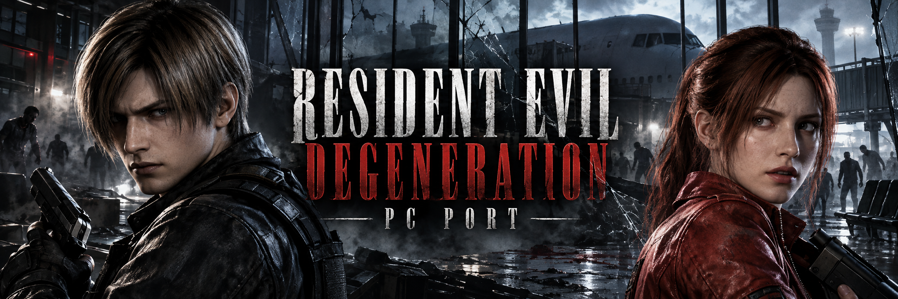
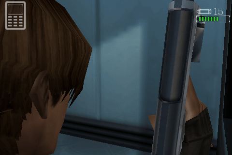
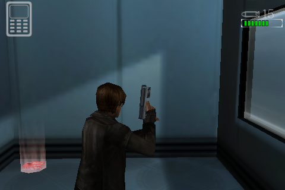
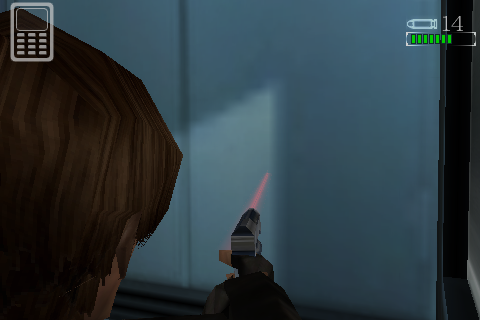
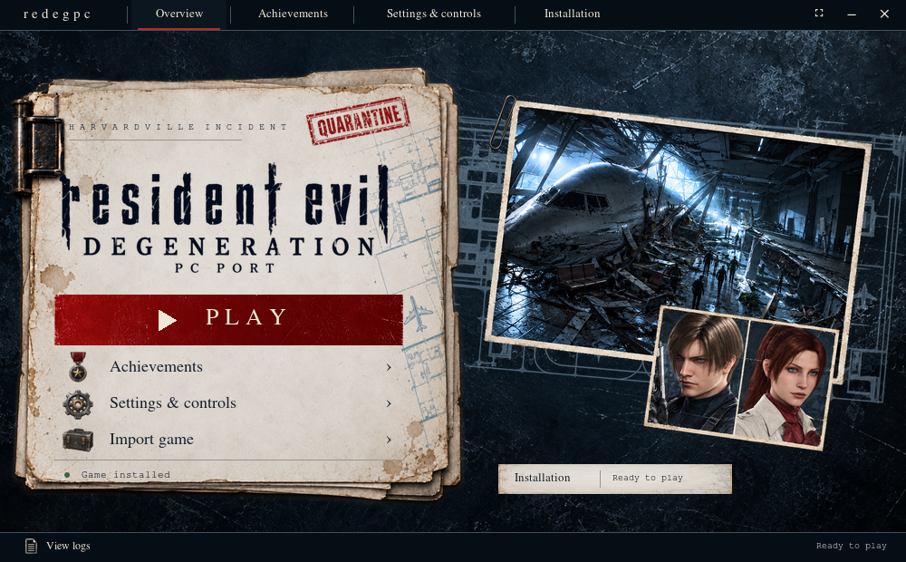

# Resident Evil Degeneration PC Port

[English](README.md) · **Español**



Juega la versión inglesa de **Resident Evil Degeneration para iPhone** en Linux con teclado y ratón, un lanzador de escritorio y partidas locales. `redegpc` es un host de compatibilidad escrito en Rust y basado en la revisión `ca1de89c578e79746f33c1332e28efd106c334ba` de touchHLE.

**Debes aportar tu propio juego:** solo se admite el **IPA de iPhone en inglés v1.03.00 sin cifrar**. El proyecto no incluye archivos del juego. Es un proyecto experimental de preservación; la compatibilidad completa durante el juego aún no está establecida.

[Jugabilidad](#jugabilidad) · [Inicio rápido](#inicio-rápido) · [Archivos del juego](#archivos-del-juego) · [Controles](#controles) · [Desarrollo](#desarrollo)

## Jugabilidad

Capturas reales del juego en Linux, a su resolución original de **480×320**.

| Exploración del aeropuerto | Apuntar y disparar |
| --- | --- |
|  |  |
|  |  |

El banner es una ilustración de aficionados; las capturas y los GIF muestran el proyecto en ejecución. Consulta la [procedencia del material visual](docs/media/README.md) (en inglés).

## Requisitos

- **Linux x86_64** con escritorio gráfico.
- Rust, compiladores de C/C++, CMake, cabeceras de Boost, `pkg-config`, cabeceras de desarrollo de liblzma (XZ) y dependencias de desarrollo de SDL/OpenAL.
- **Python 3.10 o posterior, Tk y Pillow** para el lanzador.
- **FFmpeg** en `PATH` para el vídeo y audio de la introducción original.

Conserva `Cargo.lock` y las revisiones fijadas de los submódulos. La [documentación de compilación](dev-docs/building.md) y la [guía de dependencias del lanzador](launcher/README.md#install-and-open-the-launcher) detallan los paquetes y la preparación de Python (en inglés).

## Inicio rápido

Instala los requisitos del sistema y ejecuta:

```sh
git clone https://github.com/aurelioochoa/redegpc.git
cd redegpc
git submodule update --init --recursive
python3 -m venv .venv
. .venv/bin/activate
python -m pip install -r launcher/requirements.txt
make launcher
```

`make launcher` compila el host optimizado y abre el lanzador con aspecto de expediente. En **Installation**, selecciona el IPA compatible y espera a **Ready to play**; después, usa **Overview → Play**. El primer inicio prepara una caché local de recursos y tarda más.

Para importar y jugar desde la terminal:

```sh
CARGO_BUILD_JOBS=4 cargo build --locked --release --bin redegpc
./target/release/redegpc import "/ruta/a/Resident Evil Degeneration - v1.03.00.ipa"
./target/release/redegpc check
./target/release/redegpc run
```

## Archivos del juego

Solo se admite el paquete **`jp.co.capcom.residentevil.en`**, versión **`1.03.00`**, con un **ejecutable ARM Mach-O sin cifrar**. Selecciona el `.ipa` intacto; no lo extraigas antes. Se rechazan otras versiones, idiomas y ejecutables cifrados.

La importación valida la aplicación, la copia al almacenamiento local, registra sus hashes SHA-256 y cambia de instalación solo al terminar correctamente. Una importación rechazada conserva las instalaciones y partidas existentes. Después de importar, ya no necesitas el IPA de origen ni la unidad externa. `check` verifica los originales instalados; la caché decodificada se guarda aparte y puede regenerarse.

Consulta los [detalles de importación y recuperación](launcher/README.md#import-your-game) y la [guía detallada de uso](docs/advanced-usage.md#build-and-play) (en inglés).

## Lanzador



- **Installation:** importa y verifica el juego.
- **Overview:** inicia el juego tras verificarlo.
- **Settings & controls:** guarda las preferencias de pantalla, entrada y volumen para el próximo inicio; permite elegir el icono de escritorio.
- **Achievements:** muestra 23 objetivos propuestos y filtros por categoría. El seguimiento de logros durante el juego no está implementado.
- **View logs:** muestra los registros de importación, verificación y ejecución.

F11 alterna la pantalla completa del lanzador independientemente de la preferencia del juego. Tab y Shift-Tab recorren los controles; Enter o Espacio los activan.

Ejecuta `make desktop` para instalar la entrada del menú, el acceso directo de escritorio y `~/.local/bin/redegpc`. Con un entorno virtual activo, usa `make desktop PYTHON=.venv/bin/python`. El comando instalado abre el lanzador sin argumentos; `redegpc run` inicia directamente el juego. Conserva este repositorio en su ubicación. `make uninstall-desktop` elimina los accesos y conserva el juego y las partidas. Consulta la [guía completa del lanzador](launcher/README.md) (en inglés).

## Controles

| Entrada | Acción |
| --- | --- |
| W / A / S / D o flechas | Moverse |
| Mantener botón derecho y mover el ratón | Apuntar |
| Botón izquierdo mientras apuntas | Disparar |
| R | Recargar |
| Mantener Espacio | Librarse de un agarre |
| E | Acción contextual |
| Tab | Abrir el inventario |
| Escape | Pausa / volver |
| F11 | Alternar la pantalla completa del juego |

Los menús mantienen la navegación con el puntero. El modo de escritorio oculta los gráficos táctiles de movimiento, apuntado/disparo, cuchillo y caminar; conserva las acciones contextuales, salud, munición y acceso al teléfono. E sigue el icono contextual actual; sin una interacción cercana puede activar el apuntado nativo. Al perder el foco se liberan las entradas mantenidas.

Usa `./target/release/redegpc run --touch` para los controles táctiles originales. También existen `--fullscreen`, `--windowed`, `--volume=0..100` y `--fps`; las preferencias de pantalla, entrada y volumen se guardan. Escape, Enter, Espacio o un clic omiten el vídeo. Consulta el [comportamiento detallado del runtime](docs/advanced-usage.md#build-and-play) (en inglés).

## Partidas y ajustes

| Contenido | Ubicación predeterminada |
| --- | --- |
| Instalaciones importadas, manifiesto y caché | `~/.local/share/redegpc` |
| Partidas | `~/.local/share/redegpc/touchHLE_sandbox` |
| Ajustes y opciones de touchHLE | `~/.config/redegpc` |
| Registro de ejecución | `~/.local/state/redegpc/logs/redegpc.log` |

`XDG_DATA_HOME`, `XDG_CONFIG_HOME` y `XDG_STATE_HOME` sustituyen los directorios base correspondientes. La caché de recursos se puede regenerar; eliminar el directorio de datos también elimina las partidas. Se conservan las instalaciones anteriores y un bloqueo del sistema impide ejecutar varias instancias sobre las mismas partidas.

## Estado y limitaciones

El proyecto sigue en validación local. Una compilación correcta o una captura del juego no demuestran compatibilidad con toda la campaña. Consulta los [resultados observados y defectos pendientes](docs/qualification.md) y los [criterios de aceptación](GATES.md) (en inglés).

El runtime conserva la resolución y el ritmo originales. La caché decodificada mejora las cargas posteriores sin alterar los originales importados. El lanzador permite consultar objetivos propuestos, pero no otorga logros. La plataforma objetivo actual es Linux x86_64.

## Desarrollo

| Comando | Función |
| --- | --- |
| `make help` | Mostrar los objetivos disponibles |
| `make setup` | Inicializar submódulos, descargar dependencias fijadas y comprobar requisitos del lanzador |
| `make build` | Compilar el host optimizado |
| `make dev` / `make launcher` | Compilar y abrir el lanzador |
| `make run ARGS="--windowed --fps"` | Ejecutar con opciones adicionales |
| `make check-game` | Verificar el juego importado (`check-install` es un alias) |
| `make check` | Comprobar Rust sin enlazar |
| `make verify` | Compilar y ejecutar formato, Clippy específico, pruebas de biblioteca y CLI sintética |
| `make test-launcher` | Ejecutar pruebas aisladas del lanzador con pantalla gráfica |
| `make clean` / `make distclean` | Eliminar cachés de Python / limpiar también los artefactos de Cargo |

La compilación usa cuatro tareas de Cargo por defecto; cambia el valor con `CARGO_BUILD_JOBS=8 make build`. La limpieza conserva el juego y las partidas. El runtime heredado sigue disponible con `cargo run --locked --release --bin touchHLE -- ...`.

Consulta la [guía detallada de uso, arquitectura y herramientas de validación](docs/advanced-usage.md), las [mediciones de carga](docs/qualification.md#loading-optimization-2026-10-16) y el [README de touchHLE](README.touchHLE.md) (en inglés).

## Licencia y créditos

Basado en **touchHLE**, conservando su historial y avisos. El nuevo código del host y de compatibilidad sigue los avisos **MPL-2.0**; el binario combinado documentado es **GPL-3.0-or-later**. Cada componente conserva su licencia. Consulta [LICENSE](LICENSE), las [condiciones originales](README.touchHLE.md) y los [avisos de redegpc](NOTICE.redegpc.md).

Resident Evil Degeneration y sus recursos pertenecen a sus respectivos propietarios. El juego no se distribuye aquí; los recursos del runtime y las dependencias conservan sus avisos obligatorios.
