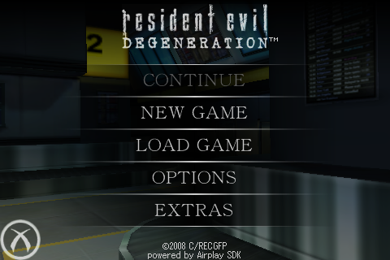

[English README](../README.md#english) · [README en español](../README.md#español)

Detailed reference retained from the project README. Commands run from the repository root.

# Detailed usage and implementation


Play the English iPhone release on Linux with keyboard and mouse controls, a native desktop launcher, and local saves. Bring your own **Resident Evil Degeneration v1.03.00** IPA; game files are not included.

Rust host for the English **Resident Evil Degeneration v1.03.00** IPA, based on touchHLE revision `ca1de89c578e79746f33c1332e28efd106c334ba`.

This implementation is under local qualification. See [observed results and remaining defects](../docs/qualification.md) and [acceptance gates](../GATES.md); a successful build does not establish playable compatibility.

## Gameplay

Actual gameplay captured from the Linux build, at the game's native 480×320 resolution.

| Exploring the airport | Aiming and firing |
| --- | --- |
|  |  |

## Screenshots

| Airport exploration | Over-the-shoulder aiming |
| --- | --- |
|  |  |
| **Title screen** | **Native desktop launcher** |
|  |  |

The banner is original illustrated fan artwork. Screenshots and GIFs show the running project; see [media provenance](../docs/media/README.md).

## Build and play

Build on Linux x86_64 with Rust, C/C++ compilers, CMake, Boost headers, pkg-config, liblzma development headers (xz), and the native SDL/OpenAL development dependencies. FFmpeg must be on PATH for the original intro. Keep the pinned submodules and Cargo.lock:

```sh
git clone https://github.com/aurelioochoa/redegpc.git
cd redegpc
git submodule update --init --recursive
CARGO_BUILD_JOBS=4 cargo build --locked --release --bin redegpc
./target/release/redegpc import "/path/to/Resident Evil Degeneration - v1.03.00.ipa"
./target/release/redegpc check
./target/release/redegpc run
```

The default executable is `redegpc`; `cargo run --locked --release -- --help` shows the CLI. The inherited runtime remains available as `cargo run --locked --release --bin touchHLE -- ...`. A dynamically linked build is available with `--no-default-features` and system SDL2/OpenAL Soft. The default bundled build disables the pinned SDL's obsolete direct PipeWire backend; PulseAudio/ALSA remain available. CMake 4 and GCC 16 compatibility adaptations keep vendor revisions unchanged.

The Makefile provides shortcuts: `make build`, `make import IPA="/path/to/game.ipa"`, `make check-install`, and `make run ARGS="--windowed --fps"`. Use `make verify` for the existing project checks and `make help` for all targets. `make dev` and `make launcher` open the native incident dossier launcher using the optimized release host; `make debug` remains available for source debugging. Builds default to four Cargo jobs; override with `CARGO_BUILD_JOBS=8 make build`.

All three PC hosts (`re4mepc`, `redegpc` and `bio3dpc`) share the core targets
`help`, `setup`, `dev`, `build`, `run`, `test`, `check`, `verify`, `fmt`, `clean`
and `distclean`. Plain `make` shows grouped help. `make setup` initializes native
submodules, fetches locked Rust dependencies and checks Python/Tk/Pillow; install
the system prerequisites listed above and the launcher dependencies first.
`make check` checks Rust without linking. `make verify` also builds release
binaries and runs formatting, focused Clippy, library and synthetic CLI checks.
`make clean` removes Python caches while keeping Cargo artifacts; use
`make distclean` to run Cargo cleanup as well. Both preserve game files and saves.
`make check-game` validates imported game files; `make check-install` remains
an alias. `NO_COLOR=1` disables help colours; `FORCE_COLOR=1` enables them.

The [native launcher installation guide](../launcher/README.md) covers Python/Tk/Pillow setup, importing your supported IPA, first launch, storage and troubleshooting. Open it with `make launcher` or `./target/release/redegpc launcher`. Use `make desktop` to install a desktop icon and applications-menu entry that open the launcher; keep this checkout in place. In **Installation**, choose your intact, unencrypted English iPhone v1.03.00 `.ipa`, wait for **Ready to play**, then use **Overview → Play**. The first launch prepares a local cache and takes longer; after import, the source archive/drive is no longer required. The game is not included. The launcher provides installation verification, persistent display/input/volume settings and live logs. Resize adapts the paper layout to the window, and F11 toggles launcher fullscreen independently of the game's display preference. The achievement browser includes all 23 proposed goals and category filters; gameplay achievement tracking is not implemented. `make test-launcher` runs isolated interaction checks on a graphical display.

Import requires the English bundle `jp.co.capcom.residentevil.en`, version `1.03.00`, with an unencrypted ARM Mach-O. Import is bounded, rejects traversal/unsafe symlinks/duplicate paths, extracts into a staging directory, validates the app, hashes every file using SHA-256, and atomically changes the current installation pointer. Existing installations and saves survive rejected imports. The source IPA and external drive are unnecessary after import. Original `main.dz` and configuration bytes are retained. Apple’s standard CodeResources signature alias is materialized as a regular file; its original target is recorded in the manifest. `check` rehashes all installed files and rejects unexpected files or symlinks. A crash may leave a staging directory or import lock; remove the lock only after confirming no importer is active. Previous installations are retained to avoid destructive replacement.

See the [measured loading improvement](../docs/qualification.md#loading-optimization-2026-10-16). On Linux, the first launch prepares a decoded copy of `main.dz` under the data directory's `cache/assets-v1`. Later launches and level transitions read the cached assets directly, avoiding repeated ARM LZMA decompression. The imported archive stays byte-for-byte intact and `check` still verifies the originals. Cache entries are tied to the source digest, checked on reuse, and rebuilt automatically if damaged. If preparation fails, the original loader remains available. Deleting the cache is safe; the next launch regenerates it. A separate cached loading profile batches serialization callbacks in 1 MiB chunks (with a 50 ms progress interval) to keep progress responsive. The original configuration is retained; gameplay, logos and story cutscene timing are unchanged; the usual touch controls skip those sequences.

Running with no subcommand launches the imported game or explains import when no installation exists. Launch options include `--fullscreen`, `--windowed`, `--volume=0..100`, `--touch`, `--desktop`, `--fps`, and `--resources <directory>`; display/input/volume settings persist. F11 toggles fullscreen for the current session. The game runs at its original 480×320 internal resolution in landscape, with aspect-preserving presentation and inherited timing. Driver swap waits are explicitly disabled because the guest and compositor already pace frames; an additional driver wait can stall game updates even while the compositor reports 60 FPS. The game profile enables forced composition: Airplay waits for a draw callback which the inherited fullscreen fast path omits.

Desktop actions: WASD/arrows movement, hold right mouse and move the mouse to aim, left mouse fire while aiming and pointer clicks in menus, R reload (simulated screen tip), hold Space to shake off a grab, E contextual action, Tab inventory, Escape pause/back. Desktop mode removes the touch movement pad, aim/fire, knife and walk graphics and blocks ordinary mouse clicks on their gameplay targets. The phone shortcut stays visible and clickable; menus keep normal mouse navigation. Use E for contextual gameplay actions. Contextual icons (pickup, doors, kicks, ladders, jumps, reload and shake-off), health/ammo and menus remain visible. Keyboard actions use separate synthetic input, so mouse clicks on the removed controls cannot change the keyboard control state. Game assets and saves are unchanged. Movement drags from the control-pad center. Inventory opens the phone’s Items page; Escape closes it or opens the phone menu. Aim uses timed taps so holding right mouse does not fire. E follows the current action icon; without a nearby interaction that icon enters native aim mode. Focus loss releases held inputs and cancels pending navigation. A per-data-directory OS lease prevents overlapping runtimes from rotating the same saves. `--touch` preserves original pointer/touch control and all touch-control graphics, and still plays the movie.

Storage follows XDG, with standard home-directory fallbacks:

| Contents | Location |
|---|---|
| Imported installations and current manifest | `$XDG_DATA_HOME/redegpc` (`~/.local/share/redegpc`) |
| Persistent saves | data directory's `touchHLE_sandbox` |
| Settings and additional upstream options | `$XDG_CONFIG_HOME/redegpc` (`~/.config/redegpc`) |
| Runtime log | `$XDG_STATE_HOME/redegpc/logs/redegpc.log` (`~/.local/state/redegpc/logs/redegpc.log`) |

Resources resolve next to the executable (`resources/` or `../share/redegpc/`), then the source checkout compiled into a development build. Use `--resources` to select them explicitly. A moved binary needs `touchHLE_dylibs`, `touchHLE_fonts`, and `touchHLE_default_options.txt` in that resource directory, including all their notices. No working-directory changes are made. The public Rust `redegpc::runtime::run(RuntimeConfig)` entry accepts app, resource, data, config and log directories plus typed game settings, and initializes one runtime per process on the main thread.

Movie playback uses FFmpeg to decode local MPEG-4/AAC into bounded RGBA frame queues and PCM, draws into the runtime's existing window, and plays PCM through SDL. Guest completion notifications (ended, failed or user exit) run on the guest run loop. Escape/Enter/Space, click or touch skips the movie. FFmpeg errors are explicit and return control through a failure notification. The original runtime's simulated playback remains for other applications.

Run `python scripts/verify.py` for locked release build, formatting, focused Clippy, and library tests. See [upstream build documentation](../dev-docs/building.md), [original README](../README.touchHLE.md), and [notices](../NOTICE.redegpc.md). The game and its assets are not distributed here.

Development qualification: `REDEGPC_TRACE=touchHLE::fs,touchHLE::window` enables focused traces. `REDEGPC_TRACE=touchHLE::redegpc::asset_cache` logs cache verification timing; `REDEGPC_ORIGINAL_ASSETS=1` temporarily uses the original compressed archive and loading configuration for comparisons. `REDEGPC_FRAME_TRACE=/absolute/new-file.csv` records presentation intervals; use `python scripts/summarize_frames.py` to summarize them. `scripts/qualify_launches.py` checks repeated real X11 menu launches against reviewed positive and negative captures, and can hide the source drive in each child mount namespace using Bubblewrap. `scripts/check_active_qualification.py` independently recounts active-world time and verifies captured frames from a soak. These helpers require Pillow (12.3+) and graphical captures use an accessible X11 display; they are development tools.
